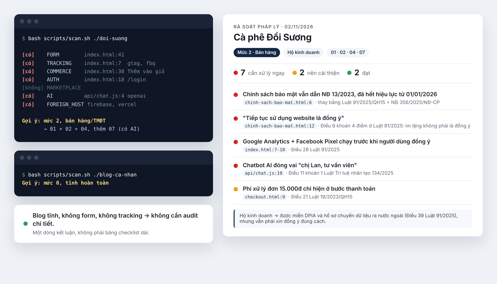

# vn-law-check

**Code do AI viết thì để AI soi luật luôn.** Bảo agent "audit pháp lý site này", nó quét code rồi chỉ ra chỗ site đang dính luật Việt Nam: file nào, dòng nào, điều luật nào. Thấy lỗi thì bảo nó sửa tiếp. Dùng được cho cả mobile app (React Native, Expo, Flutter, Android, iOS).

Dùng với Claude Code, Cursor, Copilot, Windsurf, Cline. Theo luật mới 2025-2026: dữ liệu cá nhân, TMĐT, an ninh mạng, người tiêu dùng, quảng cáo, AI.



**Site bạn có ô nhập email hoặc số điện thoại?** Vậy là đang thu thập dữ liệu cá nhân. Từ 01/01/2026, Luật Bảo vệ dữ liệu cá nhân 91/2025 bắt phải báo rõ thu dữ liệu để làm gì và xin đồng ý đúng cách. Site vibe code thường chưa có trang chính sách nào. Site cũ thì hay có chính sách copy từ đâu đó, vẫn ghi "Nghị định 13" dù văn bản này hết hiệu lực từ 01/01/2026. Rơi vào trường hợp nào thì cũng nên chạy thử. Xem [báo cáo trên shop demo](demo/report.md) để biết agent tìm được những gì.

### Cài nhanh

Dùng Claude Code: cài qua plugin marketplace (gõ trong Claude Code, không phải terminal):

```
/plugin marketplace add mhfed/vn-law-check
/plugin install vn-law-check
```

Hoặc clone thẳng vào thư mục skills, không cần qua marketplace:

```bash
git clone --depth=1 https://github.com/mhfed/vn-law-check ~/.claude/skills/vn-law-check
```

(muốn cài riêng cho 1 project thì đổi `~/.claude/skills/` thành `.claude/skills/` trong project đó)

Dùng Cursor/Windsurf/Copilot/Cline/Codex: chạy lệnh này trong thư mục project:

```bash
curl -fsSL https://raw.githubusercontent.com/mhfed/vn-law-check/main/install.sh | bash
```

Script cài checklist vào `.vn-law-check/` và không ghi đè file nào của bạn. Nếu project đã có `AGENTS.md`, `CLAUDE.md`... thì script chỉ chèn thêm một đoạn ngắn trỏ tới `.vn-law-check/`. Chạy lại để cập nhật cũng không bị chèn trùng.

Xong thì bảo agent: "audit pháp lý website này theo luật Việt Nam". Không có source code, chỉ có địa chỉ website cũng được: "audit pháp lý https://ten-mien.vn". Agent sẽ tự quét code để phân loại site trước. Blog hay trang tĩnh không thu thập gì thì chỉ nhận về 1 dòng kết luận, không phải bảng checklist dài.

Không phải tư vấn pháp lý, xem [DISCLAIMER.md](./DISCLAIMER.md). Luật ở mảng này vừa đổi gần hết trong 2025-2026, nên tự xác minh lại trước khi dựa vào.

### Vì sao làm cái này

Rules compliance có sẵn trên GitHub cho AI agent gần như toàn GDPR/CCPA. Chưa có cái nào theo luật Việt Nam, trong khi luật VN vừa thay gần hết: Luật Bảo vệ dữ liệu cá nhân 2025, Luật Thương mại điện tử 2025, Luật An ninh mạng 2025 đều mới có hiệu lực trong 2026, thay các nghị định cũ.

### Dùng với tool nào

Cùng một nội dung, đặt ở nhiều file để mỗi tool tự đọc đúng chỗ của nó, không cần config gì thêm:

- `AGENTS.md`: chuẩn chung (Cursor, Codex, Jules, Amp, Zed...)
- `CLAUDE.md`: Claude
- `SKILL.md`: Claude Skill, cho vào `.claude/skills/`
- `.claude-plugin/marketplace.json` + `plugins/vn-law-check/`: để cài qua `/plugin marketplace add` trong Claude Code
- `.cursor/rules/vn-legal-compliance.mdc`: Cursor
- `.windsurfrules`: Windsurf
- `.github/copilot-instructions.md`: GitHub Copilot
- `.clinerules`: Cline

### Cấu trúc

```
references/   00-triage (phân loại site trước khi audit) + 9 checklist theo lĩnh vực, gồm 1 checklist riêng cho mobile app
scripts/      scan.sh: quét source code hoặc URL, phát hiện form/tracking/giỏ hàng/đăng nhập/AI/hosting,
              và với mobile app: quyền truy cập, SDK tracking/quảng cáo, chức năng xóa tài khoản
              fetch-site.sh: tải trang công khai của một URL để scan.sh quét
sources/      văn bản pháp luật dẫn chiếu, ngày hiệu lực, link
examples/     mẫu báo cáo: rút gọn (site nhỏ) và đầy đủ (bán hàng, nền tảng)
tests/        site mẫu để kiểm tra scan.sh phân loại đúng
tools/        sync.sh: sinh các bản copy cho từng tool từ nguồn gốc
```

`scan.sh` quét thư mục code thì chỉ đọc file local. Quét theo URL thì gọi `fetch-site.sh` tải các trang công khai của chính site đó (tối đa 15 trang và 20 file JS cùng tên miền), không gửi dữ liệu đi đâu khác. Quét site người khác thì cũng chỉ thấy những gì ai mở trình duyệt cũng thấy, nhưng kết quả nhớ gửi riêng cho chủ site, đừng đem đi bêu tên.

### Tình trạng nội dung

Cập nhật 02/11/2026, theo các văn bản mới nhất: Luật BVDLCN 91/2025 + NĐ 356/2025, Luật TMĐT 122/2025 + NĐ 248/2026, Luật An ninh mạng 116/2025 + NĐ 333/2026, Luật Quảng cáo sửa đổi 75/2025 + NĐ 342/2025, Luật Trí tuệ nhân tạo 134/2025 + NĐ 142/2026.

Mỗi mục checklist có dẫn Điều/khoản. Số điều nào chưa đối chiếu được với toàn văn thì ghi "CHƯA XÁC MINH" ngay tại chỗ, phần lớn là các nghị định xử phạt. Toàn bộ link văn bản ở `sources/legal-references.md`.

### Thấy sai? Vào bắt lỗi giúp

Mình là dev, không phải luật sư. Đọc hiểu tới đâu thì viết vào checklist tới đó, chỗ nào chưa chắc thì ghi thẳng "CHƯA XÁC MINH". Đếm lại thì còn 32 chỗ như vậy 😅 Phần lớn nằm ở các nghị định xử phạt (`references/08-penalties-reference.md`) và NĐ 356/2025 (`references/01-personal-data-protection.md`).

Nên nếu bạn làm luật, hoặc đơn giản là đọc luật kỹ hơn mình, vào bắt lỗi giúp. Không cần biết code, [mở một issue](https://github.com/mhfed/vn-law-check/issues/new/choose) theo mẫu có sẵn là được:
- Thấy chỗ sai: số điều, văn bản hết hiệu lực, mức phạt, cách hiểu chưa chuẩn
- Thấy chỗ thiếu: luật mới, lỗi hay gặp mà checklist chưa có
- Tool xếp nhầm site của bạn

Kèm link văn bản gốc là mình kiểm tra được ngay. Hứa không cãi, chỉ sửa và ghi tên bạn vào bản cập nhật.

**Gửi PR trực tiếp:** chỉ sửa file nguồn gốc: `AGENTS.md`, `SKILL.md`, `references/`, `sources/`, `examples/`, `scripts/`, `DISCLAIMER.md`. Sau đó chạy `tools/sync.sh` để sinh lại `CLAUDE.md`, rules cho Cursor/Windsurf/Copilot/Cline và bản trong `plugins/`. CI sẽ báo lỗi nếu quên đồng bộ. Sửa `scripts/scan.sh` thì chạy `tests/run.sh` để kiểm tra.

MIT license cho phần code/cấu trúc repo. Văn bản pháp luật được dẫn chiếu là tài liệu công khai của Nhà nước, không thuộc phạm vi license này.
